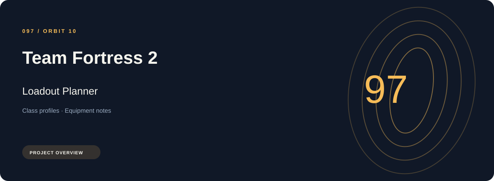
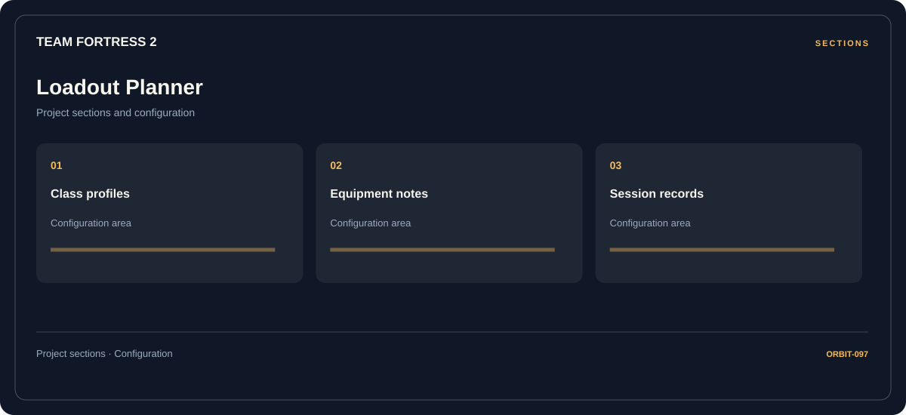

# 🎮 Team Fortress 2 Loadout Planner

**Class profiles · Equipment notes · Session records**

## ⚡ Features

The Team Fortress 2 loadout planner workflow separates class profiles from equipment notes and session records. Named sections make the available options easier to find.

### ⚙️ Class profiles

Related settings collected into named groups for a clearer configuration workflow.

### 🧩 Equipment notes

Equipment categories and the associated selection or configuration options.

### ⌨️ Session records

Session and activity information grouped by the task or context it belongs to.

## 🖥️ Project navigation

## 📥 Download

The button and cover open the project's download page. Use the information supplied with the downloaded package for installation and release-specific requirements.

## 📚 Project documentation

- [Feature reference](docs/FEATURES.md)
- [Download information](docs/DOWNLOAD.md)
- [Project page](index.html)

---

Team Fortress 2 Loadout Planner · Program documentation and download information.
